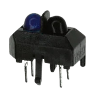

# Cliff Detection — Component Selection

## Part 1: Component Comparison

The purpose of the Cliff Detection subsystem is to detect when the robot approaches an edge or drop-off. Three sensors were considered based on cost, sensing capabilities, electrical requirements, and integration with the PIC18F57Q43 microcontroller.

### 1. TCRT5000 Infrared Reflective Sensor

**Price:** $1.63

**Pros:**
- Low-cost and readily available.
- Compact design with an infrared emitter and phototransistor.
- Can detect changes in reflected infrared light.
- Simple analog interface with the PIC18F57Q43.

**Cons:**
- Reflectivity changes with floor color and material.
- Requires external resistors and signal conditioning.
- Sensitive to sensor mounting height and alignment.
- Does not directly measure distance.

[View TCRT5000 on DigiKey](https://www.digikey.com/en/products/detail/vishay-semiconductor-opto-division/TCRT5000/1681167)

### 2. VL6180X-SATEL Time-of-Flight Sensor

**Price:** $22.70 (assignment reference)

**Pros:**
- Measures physical distance rather than reflected light intensity.
- Less affected by floor color.
- Provides precise distance measurements.
- Compact optical sensor.

**Cons:**
- Higher cost than the TCRT5000.
- Requires I2C communication.
- More complex software integration.
- Measurement timing must be considered.

[View VL6180X-SATEL on DigiKey](https://www.digikey.com/en/products/detail/stmicroelectronics/VL6180X-SATEL/5168368)

### 3. VL53L0CXV0DH/1 Time-of-Flight Sensor

**Price:** $4.63 (assignment reference)

**Pros:**
- Measures physical distance using time-of-flight technology.
- Less dependent on surface reflectivity.
- Compact footprint.
- Supports precise distance threshold detection.

**Cons:**
- Requires low-voltage power and compatible logic levels.
- Uses I2C communication.
- Requires additional software configuration.
- Surface-mount package complicates assembly.

[View VL53L0CXV0DH/1 on DigiKey](https://www.digikey.com/en/products/detail/stmicroelectronics/VL53L0CXV0DH-1/6023691)

## Part 2A: Electrical Requirements

The following values were recorded in the initial component comparison.

| Component | Voltage | Current Listed |
|---|---|---|
| PIC18F57Q43 Curiosity Nano | 3.3V / 5.0V | 50 mA |
| TCRT5000 | 5.0V | 60 mA |
| VL6180X-SATEL | 2.8V–5.0V | 19 mA |
| VL53L0CXV0DH/1 | 2.8V–3.3V | 19 mA |

**Important:** The TCRT5000's 60 mA value is the infrared LED's absolute maximum continuous forward current, not its required operating current.

The sensor contains two electrically separate components:
1. Infrared LED — requires a current-limiting resistor.
2. Phototransistor — requires a sensing circuit to produce a usable output voltage.

## Part 2B: Final Component Selection

### Selected Component: TCRT5000

The TCRT5000 was selected for the Cliff Detection subsystem because of its low cost, compact size, and relatively simple electrical interface.

The sensor uses an infrared LED to illuminate the floor and a phototransistor to detect reflected infrared light.

When the robot travels over a reflective surface, infrared light returns to the phototransistor. When the robot approaches an edge, the amount of reflected light decreases. The PIC18F57Q43 can monitor this change and determine whether a possible cliff is present.

Compared with the VL6180X-SATEL and VL53L0CXV0DH/1, the TCRT5000 does not require I2C communication. This simplifies integration with the microcontroller.

The primary disadvantage is sensitivity to different floor materials and colors. Testing and calibration will be required to establish reliable detection thresholds.

### Integration Plan

1. Supply the infrared LED through a current-limiting resistor.
2. Connect the phototransistor to an appropriate sensing circuit.
3. Connect the sensing circuit output to a PIC18F57Q43 ADC input.
4. Calibrate the reflected-light threshold.
5. Send a cliff detection signal to the robot's control system when the threshold is crossed.

### TCRT5000 Specifications

| Parameter | Specification |
|---|---|
| Manufacturer | Vishay |
| Sensor type | Reflective infrared |
| Emitter | Infrared LED |
| Detector | Phototransistor |
| Peak operating distance | 2.5 mm |
| Specified relative sensing range | 0.2–15 mm |
| Maximum LED forward current | 60 mA |
| LED forward voltage | 1.25V typical at 60 mA |
| Package | 4-pin through-hole |

## References

- [TCRT5000 DigiKey Product Page](https://www.digikey.com/en/products/detail/vishay-semiconductor-opto-division/TCRT5000/1681167)
- [Vishay TCRT5000 Datasheet](https://www.vishay.com/docs/83760/tcrt5000.pdf)
- [VL6180X-SATEL DigiKey](https://www.digikey.com/en/products/detail/stmicroelectronics/VL6180X-SATEL/5168368)
- [VL53L0CXV0DH/1 DigiKey](https://www.digikey.com/en/products/detail/stmicroelectronics/VL53L0CXV0DH-1/6023691)
