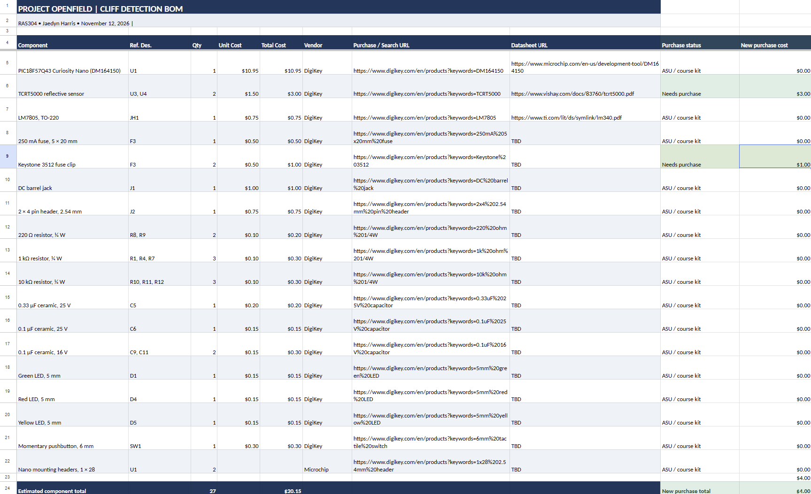

# Bill of Materials (BOM)

## Project OpenField – Cliff Detection Subsystem

---

## Overview

The following Bill of Materials (BOM) lists all components required for the Cliff Detection subsystem. The reference designators correspond to the individual KiCad schematic.

Most components are provided by Arizona State University (ASU) or included in the RAS304 course kit. The TCRT5000 sensors and fuse clips are the only components that require purchasing.

## Bill of Materials

| Reference | Component | Specification | Qty | Unit Cost | Total Cost | Status |
|-----------|-----------|--------------|-----|-----------|------------|--------|
| U1 | Curiosity Nano | PIC18F57Q43, DM164150 | 1 | $10.95 | $10.95 | ASU / Kit |
| U3, U4 | TCRT5000 | IR Reflective Sensor | 4 | $1.50 | $6.00 | Needs Purchase |
| JH1 | LM7805 | 5V Regulator, TO-220 | 1 | $0.75 | $0.75 | ASU / Kit |
| F3 | Fuse | 250 mA, 5x20 mm | 1 | $0.50 | $0.50 | ASU / Kit |
| F3 | Keystone 3512 | 5x20 mm Fuse Clip | 4 | $0.50 | $2.00 | Needs Purchase |
| J1 | DC Barrel Jack | Power Input Connector | 1 | $1.00 | $1.00 | ASU / Kit |
| J2 | Ribbon Connector | 2x4, 8-Pin, 2.54 mm | 1 | $0.75 | $0.75 | ASU / Kit |
| R8, R9 | Resistor | 220 Ω, 1/4 W | 2 | $0.10 | $0.20 | ASU / Kit |
| R1, R4, R7 | Resistor | 1 kΩ, 1/4 W | 3 | $0.10 | $0.30 | ASU / Kit |
| R10, R11, R12 | Resistor | 10 kΩ, 1/4 W | 3 | $0.10 | $0.30 | ASU / Kit |
| C5 | Capacitor | 0.33 µF, 25V | 1 | $0.20 | $0.20 | ASU / Kit |
| C6 | Capacitor | 0.1 µF, 25V | 1 | $0.15 | $0.15 | ASU / Kit |
| C9, C11 | Capacitor | 0.1 µF, 16V | 2 | $0.15 | $0.30 | ASU / Kit |
| D1 | Green LED | 5 mm, Through-Hole | 1 | $0.15 | $0.15 | ASU / Kit |
| D4 | Red LED | 5 mm, Through-Hole | 1 | $0.15 | $0.15 | ASU / Kit |
| D5 | Yellow LED | 5 mm, Through-Hole | 1 | $0.15 | $0.15 | ASU / Kit |
| SW1 | Pushbutton | Momentary, Normally Open | 1 | $0.30 | $0.30 | ASU / Kit |
| U1 | Mounting Headers | 1x28, 2.54 mm | 2 | Included | Included | ASU / Kit |

---

## Components to Purchase

| Component | Quantity | Unit Cost | Total Cost | Vendor |
|-----------|----------|-----------|------------|--------|
| TCRT5000 IR Reflective Sensor | 4 | $1.50 | $6.00 | DigiKey |
| Keystone 3512 Fuse Clip | 4 | $0.50 | $2.00 | DigiKey |
| **Total** | **4** | | **$8.00** | |

## Purchase Links

- [TCRT5000 Reflective Optical Sensor](https://www.digikey.com/en/products?keywords=TCRT5000)
- [Keystone 3512 Fuse Clip](https://www.digikey.com/en/products?keywords=Keystone%203512)

---

## Datasheets

| Component | Datasheet |
|-----------|-----------|
| PIC18F57Q43 Curiosity Nano | [Microchip Documentation](https://www.microchip.com/en-us/development-tool/DM164150) |
| TCRT5000 | [Vishay Datasheet](https://www.vishay.com/docs/83760/tcrt5000.pdf) |
| LM7805 | [Voltage Regulator Datasheet](https://www.ti.com/lit/ds/symlink/lm340.pdf) |

---

## Download BOM

The complete Bill of Materials is available as an Excel spreadsheet.

[Download Cliff Detection BOM (.xlsx)](Cliff_Detection_BOM_Final.xlsx)

---

## Cost Summary

| Category | Cost |
|----------|------|
| Components Provided by ASU | $0.00 additional |
| TCRT5000 Sensors | $3.00 |
| Fuse Clips | $1.00 |
| **Total Additional Purchase Cost** | **$4.00** |

## Notes

- All resistors are rated at 1/4 W.
- All components use through-hole mounting.
- Two fuse clips are required for the 250 mA cartridge fuse.
- Component prices are estimated and exclude shipping and taxes.
- Components supplied by ASU do not require additional purchasing.
- The BOM reference designators correspond to the Cliff Detection schematic.
