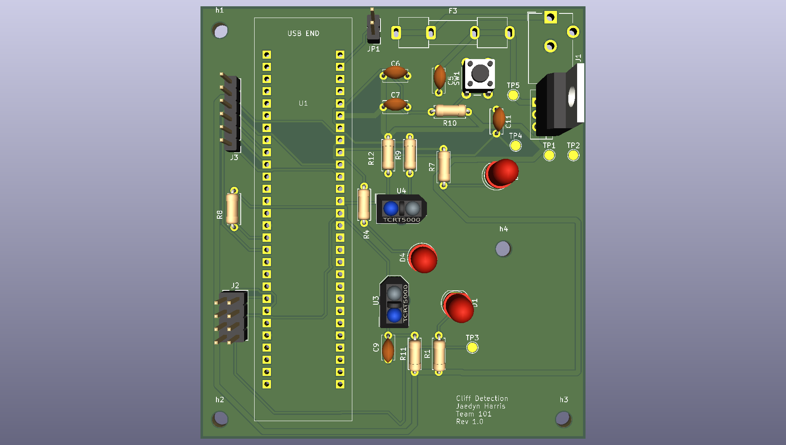
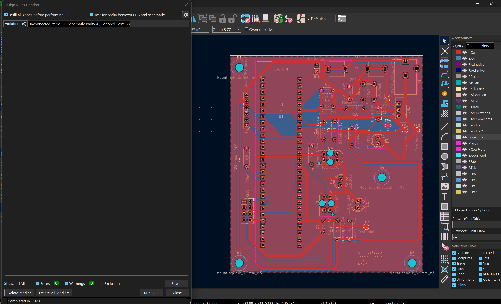
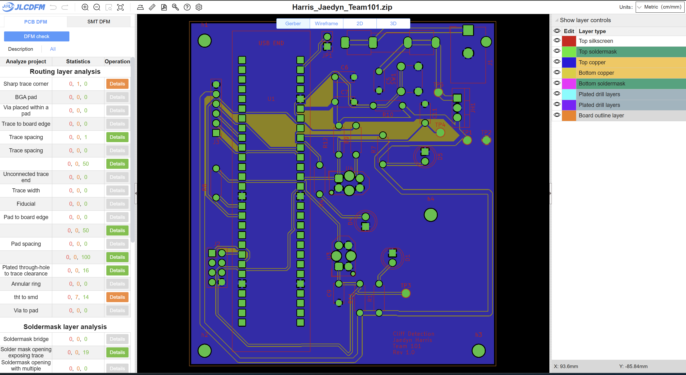

# PCB Design

## Cliff Detection Subsystem

The PCB was designed in KiCad for the cliff detection subsystem. It integrates the Curiosity Nano microcontroller, infrared sensors, power circuitry, status LEDs, and connectors.

## PCB Layout

## Design Specifications

| Parameter | Specification |
|---|---|
| Board Dimensions | 80 mm × 90 mm |
| Copper Layers | 2 |
| Power Trace Width | 1.016 mm |
| Signal Trace Width | 0.2 mm |
| Board Material | FR4 |

## Design Rules Check (DRC)

The PCB was checked using KiCad's Design Rules Checker.

- Errors: 0
- Warnings: 0
- Unconnected Items: 0

## Design for Manufacturing (DFM)

The Gerber and drill files were uploaded to JLCPCB's DFM checker to evaluate manufacturing compatibility.

## Manufacturing Files

The ZIP archive contains the Gerber and drill files required for PCB fabrication.

[Download Gerber and Drill Files](Harris_Jaedyn_Team101_p3.zip)
